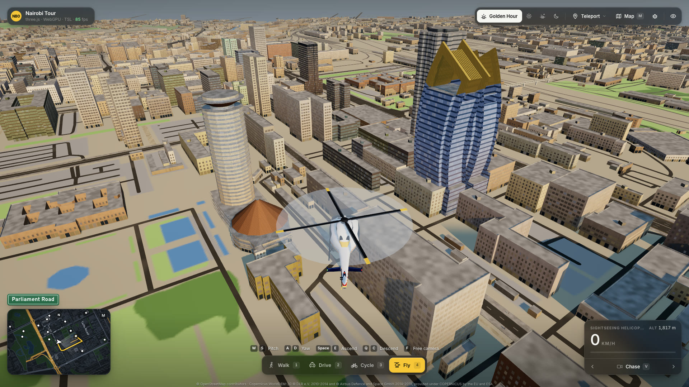

# Slop Cities - Nairobi



A Nairobi remix of [Slop New York](https://github.com/mrdoob/slop-newyork): the CBD at 1:1 on its real terrain, built with [three.js](https://threejs.org/).

## Run it

The page needs a local web server because it loads ES modules:

```bash
python3 -m http.server 8080
```

Then open http://localhost:8080. While editing, `python3 tools/serve-nocache.py 8081` serves the same files with caching off, so changed modules load on every reload.

Controls: **1–4** switch between walking, driving, cycling and the helicopter. **W**/**S** go and brake, **A**/**D** turn, **Space** jumps on foot and climbs in the helicopter, **Q**/**C** descend. Drag to look around the player and scroll to zoom. **V** steps through the cameras (**5–0** pick them directly): chase, low-angle action, first person, and fixed views of City Square, Kenyatta Avenue, Uhuru Park, Upper Hill and an aerial one. **F** switches to the free camera: click to look around (Esc releases the mouse) or drag, **WASD** moves, **Space**/**C** go up and down, **Shift** goes faster and the scroll wheel sets the speed. **Shift+1–9** fly it to the tallest towers and **Shift+0** back to the start view. **M** opens the street map, **H** hides the HUD. On a touch screen a joystick and buttons appear; a gamepad works too (left stick moves, right stick looks, the triggers drive or climb, the bumpers switch modes, Y the camera and Start the map).

Debugging, from the browser console: `window.nairobi` exposes the scene, cameras, controllers, colliders, data, traffic, lighting and the colour grade. `nairobi.roof('times')` puts the player on the roof of the tallest building whose name contains the text, `nairobi.roof(x, z)` on the building at that point, and `nairobi.roof(n)` on the nth tallest. The toolbar's Debug menu (the bug icon) does the same with a click: with **Teleport to a roof** on, clicking a building puts you on its roof (Esc turns it off).

## Make it your own

Fork it, remix it, improve it, break it. Make games, animations, films, experiments, or something completely different. Use it as a starting point and take it wherever you want. Have fun!

## Tests

```bash
npm test
```

Ports of Slop New York's controller and camera tests (`tests/`), run against Nairobi's colliders, plus checks for hills, ledges, decks, rooftop landings and the Nairobi cameras.

## Geodata

```bash
npm install                      # geotiff, for reading the elevation data
tools/fetch-geodata.sh           # OpenStreetMap via Overpass → tools/data/osm_*.json
node tools/fetch-terrain.mjs     # Copernicus GLO-30 elevation window → tools/data/dem_glo30.json
node tools/build-geodata.mjs     # → js/nairobi-geodata.js
```

- **Area:** `tools/bbox.json`. It covers the CBD, Uhuru Park and Central Park, the Railways, River Road, Ngara's southern edge and Upper Hill. Every `tools/data/q_*.overpassql` query uses the same box. If you change it, update the queries too.
- **Frame:** 1 unit = 1 m, x = east, z = south (north = -z), y = up. The origin is KICC. Kenya drives on the left (`GEO.frame.drivesOn`).
- **`GEO` contents:** `roads` (kind, lanes, one-way, width, bridge/tunnel/layer), `buildings` (footprint ring, height, `est: 1` when the height is estimated, `part: 1` for building parts), `areas` (parks, grass, water, parking…), `rivers`, `rail`, `stations`, `busStops`, `termini` (matatu/bus stations), `landmarks` (sorted tallest first), and street furniture: `signals`, `crossings`, `lamps`, `trees` and `treeRows`.
- **Terrain:** `GEO.terrain` is a 25 m grid of ground heights relative to KICC's ground, which is at 1,667 m (`base`). Heights in the box range from 1,638 m in the Nairobi River valley to 1,742 m on the Upper Hill and Kilimani ridges. The source is Copernicus GLO-30, a surface model that includes buildings and trees. The build filters it to bare ground: a ~60 m morphological opening plus light smoothing. Use `heightAt(x, z)` from `js/terrain.js` to sample it, and `baseOf(ring)` for a building's footing (the lowest point of its footprint). As a check, the Railway Station comes out at 1,661 m, the classic figure quoted for Nairobi's elevation.
- **Street furniture:** only what OSM maps, which is sparse in the CBD: 16 traffic signals, 93 crossings and 18 street lamps. Trees are better covered, with 395 trees and 42 tree rows. The sim will need to generate more of these itself.
- **Heights:** these come from OSM `height`, `building:levels` or `floors`. The towers (KICC, Times Tower, UAP Old Mutual, Britam, Teleposta, Rahimtulla…) are mapped as `building:part`s, and those parts replace their outlines. Small parts such as spires, crowns and facade fins are kept. If none of a building's parts start at ground level, the outline is kept as a podium (`podium: 1`) up to where the parts begin. Nation Centre's twin towers, for example, sit on a 10-storey base that is mapped only as the outline. About 95% of buildings have no height data in OSM. They get a fixed estimate based on size, use and distance from KICC.
- **Skyline check (Oct 2026):** checked against Wikipedia's _List of tallest buildings in Kenya_, which cites the CTBUH Skyscraper Center. Every listed tower inside the box is present and within about 6% of its listed height, except Britam, which is 195 m against the listed 200 m. Nation Centre is named "Nation Media House" in OSM; its two 83 m towers match the listed 82.9 m. Le'Mac and Sanlam Tower are in Westlands, outside the box.

## License and data

Code: MIT. Parts are adapted from Slop New York (MIT).

Geographic data © [OpenStreetMap contributors](https://www.openstreetmap.org/copyright), ODbL 1.0.

Elevation: produced using Copernicus WorldDEM-30 © DLR e.V. 2010-2014 and © Airbus Defence and Space GmbH 2014-2018, provided under COPERNICUS by the European Union and ESA; all rights reserved.
